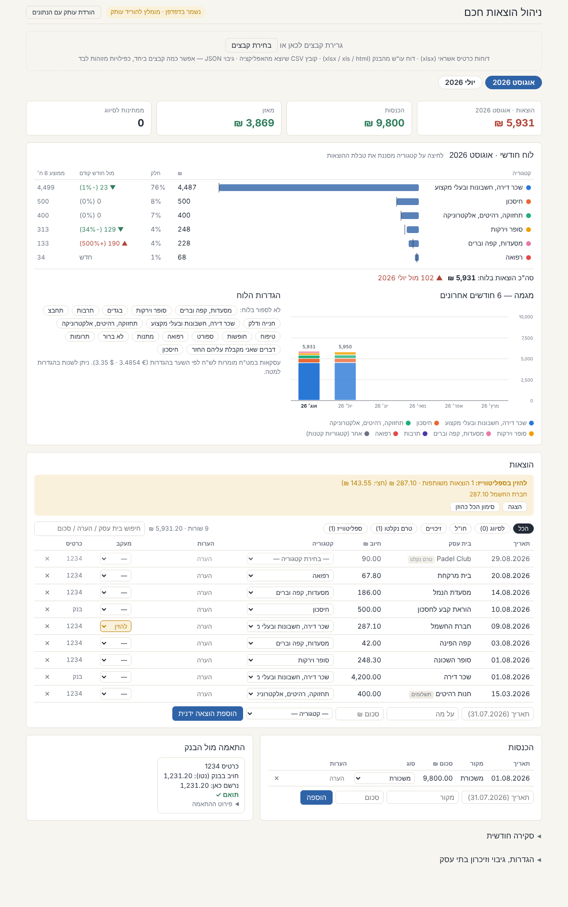

# ניהול הוצאות חכם · Smart Expense Manager

A personal expense manager for Israeli bank and credit-card statements, in **one HTML file**.
No server, no account, no libraries: your statements are parsed in the browser and never leave it.

**[Open the app](https://gonielbaz-git.github.io/expense-manager/)** · interface in Hebrew (RTL)



## What it does

- **Drag in statements, several at once.** Card statements (Isracard-style "פירוט עסקאות" `.xlsx`, Max "transaction details" `.xlsx`), bank account reports (`.xlsx`, legacy `.xls`, or saved `.html`), the app's own CSV export, and JSON backups. The format is detected automatically and duplicates are skipped, so importing overlapping files is safe.
- **Puts every row in the right month.** Purchases go to the month they were made, instalments to the month they are billed for, and bank credits to their own month (a six-month bank report does not inflate one month's income).
- **Learns your categories.** Categorise a merchant once and it is remembered, including name variants.
- **Reconciles cards against the bank.** For each card it compares what the bank charged with what is recorded, and explains the gap: purchases billed in another cycle, foreign-currency rows billed separately, instalments recorded in other months.
- **Monthly dashboard.** Per-category totals, share, change from last month, six-month average, and a six-month stacked trend. Click a category to filter the table.
- **Tracking.** Mark shared household bills to enter in Splitwise, and follow expenses someone owes you back until the refund arrives.
- **Extras.** Foreign-currency conversion at rates you set, manual (cash) expenses, search, undo for deletes and imports, light and dark themes.

## Where the data lives

Only in your browser's local storage. To back up or move to another device, use **הגדרות → הורדת האפליקציה כקובץ HTML עם כל הנתונים**: it saves a copy of the app with your data inside, which opens anywhere. A JSON backup is also available.

This repository contains no personal data. The files in `sample/` are invented.

## Try it

Open the app and drag in the three files from [`sample/`](sample).

## Develop

```
python3 build.py              # src/app.js + src/app.css  →  index.html (blank)
python3 build.py backup.json mine.html   # private copy with your own data baked in
python3 tests/make_samples.py # regenerate the invented statements (needs openpyxl)
node tests/e2e.mjs            # end-to-end test in headless Chromium (needs playwright)
```

The XLSX (zip + deflate) and legacy XLS (OLE2 / BIFF8) readers are written from scratch in `src/app.js`, so there are no dependencies to install or update.

## Notes

- Statement layouts were worked out from First International Bank (FIBI), Isracard and Max exports. Other banks that export "חובה / זכות" columns may work; other card layouts may need a parser.
- Default categories and wording are personal choices; categories can be added and removed in settings.
